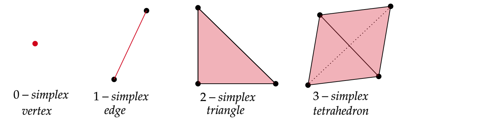
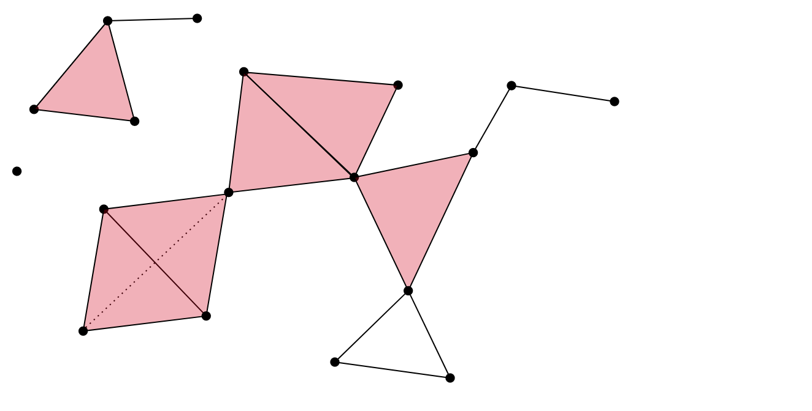
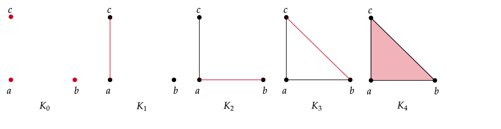
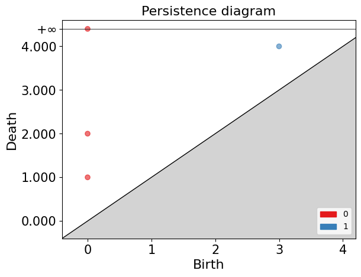
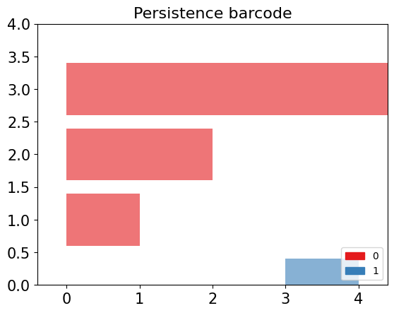

> **Instructor:** Haydee Peyurero, Alejandro Ucan-Puc · \~3.5 h (día 4, incluye un descanso)

::: {.callout-note .questions}
## Preguntas

- ¿Qué es un grafo de coocurrencia para datos de microbiomas?
- ¿Cómo podemos utilizar el TDA para analizar estos grafos?
- ¿Qué conclusiones podemos obtener de esta análisis?
:::

::: {.callout-note .objectives}
## Objetivos

- Entender cómo se construyen y utilizan los grafos de coocurrencia en el análisis de datos de microbiomas.
- Aprender a aplicar técnicas de TDA para analizar la estructura topológica de estos grafos.
- Interpretar los resultados obtenidos del análisis topológico y su relevancia en el contexto biológico.
:::

::: callout-tip
## 🧪 Cómo trabajar este capítulo

Escribimos el código **juntos, en vivo**. Abre tu notebook antes de empezar:

- **Sin instalar nada:** ábrelo en Google Colab con el botón de arriba y guarda una copia (*Archivo → Guardar una copia en Drive*) para conservar lo que escribas.
- **En tu computadora:** [descarga el notebook](notebooks/participante/leccion_4_tda.ipynb){download="leccion_4_tda.ipynb"} y ábrelo en VSCode o Jupyter.

En esta página, los bloques de código que empiezan con `⌨️` son los que escribimos juntos; el código de las gráficas viene plegado (*Ver el código de la gráfica*) y ya está escrito en tu notebook. Si te atrasas, copia el código del Etherpad o ejecuta la celda **🛟 Ponerse al día** más cercana.

Para repasar después del curso: [notebook maestro completo, con todo el código y las soluciones](notebooks/leccion04_TDA_v2.ipynb){download="leccion04_TDA_v2.ipynb"}.
:::

## Cargar los datos

Trabajamos con **75 metagenomas de rizósfera** de cultivos de tres familias de plantas (Poaceae, Solanaceae y Fabaceae; 25 muestras de cada una), provenientes de **19 estudios** publicados. Son un subconjunto de la base de datos MicroAgroBiome [@aguilar2026] (<https://agrobiom.matmor.unam.mx>). La celda de **Setup** del notebook descarga y prepara los archivos; después los cargamos:



`abundance_table` tiene una fila por muestra y una columna por género; `metadata_df`, una fila por muestra y una columna por cada dato que conocemos de ella.

La tabla de conteo de abundancias se muestra a continuación:



La tabla de taxonomías se muestra a continuación:



La tabla de metadatos se muestra a continuación:



Notemos que las muestras pertenecen a 11 plantas: *tomate, maíz, soya, cacahuate, entre otras*. Puedes ver la distribución de las muestras por planta con el siguiente código:



siendo el tomate la planta con más muestras, de las cuales al menos 20 provienen de un país conocido, ver:



## Análisis de Abundancias

Para comparar perfiles de composición, normalizamos **cada muestra por separado**:

$$\text{abundancia relativa} = \frac{\text{conteo del taxón}}{\text{suma de conteos de esa muestra}}.$$

Agrupamos características con la misma etiqueta de género; las etiquetas ausentes se conservan como `Sin asignar`. En estas gráficas, `Otros géneros` representa la abundancia que no está entre los 10 principales.



Notemos que la abundancia relativa de los géneros varía entre plantas y entre países. Por ejemplo, el género *Pseudomonas* es menos abundante en tomate que en maíz, mientras que *Sphingonomas* es más abundante en el tomate que en el resto de las plantas presentes. Dada la variabilidad de abundancias en las muestras de tomate, nos interesa analizar estas.

### Perfiles de las muestras de tomate por país

Veamos la distribución de abundancias de los 10 generos más abundantes en las muestras de tomate, agrupadas por país:



Podemos observar que las distribuciones son muy similares entre países.

## Red de Similitud

Una de las primeras formas de entender la *forma* de los datos es a través de la construcción de redes de similitud. Estas redes nos permiten visualizar cómo se relacionan entre sí las diferentes muestras o especies, identificando patrones y estructuras en los datos.

Para medir similitud entre muestras, podemos utilizar métricas como la **disimulitud de Bray-Curtis**, que cuantifica la las diferencias entre dos muestras basándose en sus abundancias relativas. La disimilitud de Bray-Curtis para abundancias relativas (no negativas) (p) y (q) se define como:

$$D_{BC}(p, q) = \frac{\sum |p_i - q_i|}{\sum (p_i + q_i)},$$

cuando las abundancias relativas están normalizadas a 1. Esta función varía entre 0 (muestras idénticas) y 1 (muestras completamente diferentes). Cabe resaltar, que la disimilitud de Bray-Curtis no es una métrica de distancia en el sentido estricto, ya que no cumple con la desigualdad triangular. Sin embargo, es ampliamente utilizada en ecología y microbiología para comparar comunidades biológicas.

Calcularemos la matriz de Bray-Curtis para los datos de abundancia de los microorganismos presentes en las muestras de Tomate, y mostrando las agrupaciones de las muestras según el continente de origen.



Esto nos permitirá observar cómo varía la diversidad microbiana según el continente y cómo se relaciona con la especie de planta y el tipo de microorganismo presente en cada muestra. Del heatmap podemos observar que las muestras de tomate provenientes de diferentes continentes presentan patrones de abundancia similares, lo que sugiere que la diversidad microbiana en estas muestras está influenciada por factores ambientales y geográficos.

Una vez que tenemos la matriz de Bray-Curtis, podemos construir un grafo de similitud de microorganismos en las muestras de Tomate, donde los nodos representan los diferentes microorganismos y las aristas representan la coocurrencia entre ellos. Esto nos permitirá observar cómo se relacionan los diferentes microorganismos presentes en las muestras de Tomate y cómo varía la diversidad microbiana según el continente y la especie de planta.



Cada nodo es una **muestra**. Se añade una arista si su disimilitud es menor o igual a $\varepsilon$. El umbral de 0.2 se utiliza **como ejemplo visual**, no como resultado óptimo ni como evidencia de agrupación. La posición de los nodos se calcula a partir de la red, **sin imponer centros geográficos**. Los colores solo se añaden al final.

::: {.callout-tip .challenge}
## ✏️ Ejercicio 1: ¿Cómo cambia el grafo con diferentes umbrales? (5 min)

A partir de `braycurtis_tomato_by_country`, calcula el rango de disimilitud, y construye un grafo de similitud basado en los quartiles del rango de disimilitud. Compara los grafos obtenidos con diferentes umbrales y describe cómo cambia la estructura de la red.
:::

### Análisis de la Red de Similitud

A simple vista, no podemos determinar cuál es la estructura de la red de similitud que describe mejor la relación entre las muestras de tomate y esto es debido a la dependencia de la red con el umbral de disimilitud que se utiliza para construirla (recordemos, que inicialmente fue 0.2).

Una forma de analizar estas relaciones es a través de la **topología de la red**, que nos permite identificar patrones y estructuras en los datos que no son evidentes a simple vista. Para ello, podemos utilizar técnicas de *Análisis Topológico de Datos (TDA)*, que nos permiten estudiar la forma de los datos y cómo se relacionan entre sí.

El TDA nos permite identificar **componentes conectados**, **ciclos** y otras estructuras topológicas en la red de similitud, lo que nos ayuda a entender mejor cómo se relacionan las diferentes muestras de tomate y cómo varía la diversidad microbiana según el continente y la especie de planta.



#### Introducción al TDA

Para estudiar datos usando la topología, necesitamos construir un objeto matemático que nos permita capturar información sobre la forma de los datos. Los datos son cúmulos de puntos en $\mathbb{R}^n$, y los complejos simpliciales son una forma de construir un objeto topológico a partir de estos puntos.

Un complejo simplicial es un conjunto de **simplices**, que son generalizaciones de triángulos y tetraedros a dimensiones superiores. Por ejemplo, un 0-simplex es un punto, un 1-simplex es una línea, un 2-simplex es un triángulo y un 3-simplex es un tetraedro.

{width="400px"}

Con los simplejos, podemos construir un complejo simplicial, que es un conjunto de simplejos que cumplen ciertas condiciones de intersección. Por ejemplo, si tenemos un conjunto de puntos en el plano, podemos construir un complejo simplicial conectando los puntos con líneas y formando triángulos.

{width="400px"}

Una forma construir un complejo simplicial a partir de un conjunto de puntos es mediante el **complejo de Vietoris-Rips**. Este complejo se construye a partir de un conjunto de puntos y un parámetro $\varepsilon$, que determina la distancia máxima entre los puntos para que se consideren conectados.

$$ \text{VR}_\varepsilon(X) = \{ \sigma \subseteq X : d(x_i, x_j) \leq \varepsilon \text{ para todos } x_i, x_j \in \sigma \}$$



Sin embargo, tenemos el mismo problema con la red de similitud: la estructura del complejo simplicial depende del parámetro $\varepsilon$. Para resolver esto, podemos utilizar **filtraciones**, que nos permiten estudiar cómo cambia la topología de los datos a medida que variamos el parámetro $\varepsilon$.

Una *filtración* es una secuencia de complejos simpliciales $\{K_\varepsilon\}_{\varepsilon \geq 0}$, donde cada complejo $K_\varepsilon$ está contenido en el siguiente $K_{\varepsilon'}$ para $\varepsilon < \varepsilon'$. Esto nos permite estudiar cómo cambian las estructuras topológicas a medida que aumentamos el parámetro $\varepsilon$.

{width="400px"}

Con la topología podemos medir cómo cambian las estructuras topológicas a medida que aumentamos el parámetro $\varepsilon$. Por ejemplo, podemos medir cómo cambian los **componentes conectados** (es decir, cómo se van conectando los puntos) y los **ciclos** (es decir, cómo se forman bucles) en la red de similitud a medida que aumentamos el parámetro $\varepsilon$. Esto nos permite construir un **diagrama de persistencia**, que nos muestra cómo cambian las estructuras topológicas a medida que aumentamos el parámetro $\varepsilon$, el eje $x$ representa el parámetro $\varepsilon$ dónde se `nacieron` las estructuras topológicas (componentes no conectadas o ciclos) y el eje $y$ representa el parámetro $\varepsilon$ dónde \`murieron' las estructuras topológicas (donde se conectan componentes o se rellenan los ciclos).

{width="400px"}

{width="400px"}

Este diagrama nos permite identificar el tipo de estructuras topológicas. Ver ejemplos en:



Para realizar el análisis topológico (homología persistente) de la red de similitud, utilizaremos la función



Esta función nos permite construir un complejo simplicial Vietoris-Rips a partir de la matriz de disimilitud de Bray-Curtis y calcular la homología persistente de la red de similitud. La función devuelve un objeto que contiene la información sobre los complejos simpliciales y los diagramas de persistencia. A continuación, presentamos los diagramas obtenidos de esta función para las muestras de tomate:



Del diagrama podemos observar que no existen ciclos persistentes en la red de similitud. Lo que indica que estas muestras de Tomate presentan una estructura muy cercana a un árbol, lo que sugiere que los microorganismos presentes en estas muestras están altamente organizados y presentan una estructura jerárquica. Esto podría indicar que los microorganismos presentes en estas muestras tienen una relación simbiótica o mutualista, lo que podría ser beneficioso para la planta de Tomate.

## Fundamentos de las Redes de Coocurrencia

En microbiología, la coocurrencia se refiere a la presencia simultánea de diferentes especies microbianas en un mismo entorno o muestra. Analizar la coocurrencia nos permite identificar posibles interacciones entre especies, como simbiosis, competencia o dependencia mutua.

Una red de coocurrencia es un grafo donde los nodos representan las especies microbianas y las aristas indican la coocurrencia entre ellas. En el contexto de los datos de microbiomas, estas redes nos permiten visualizar y analizar las interacciones entre diferentes especies en un ecosistema.

Para medir la coocurrencia entre especies, podemos utilizar diferentes métricas de correlación, como:

- **Correlación de Pearson:** mide la relación lineal entre dos variables $$r_{xy} = \frac{\sum (x_i - \bar{x})(y_i - \bar{y})}{\sqrt{\sum (x_i - \bar{x})^2 \sum (y_i - \bar{y})^2}}.$$
- **Correlación de Spearman:** mide la relación monotónica entre dos variables independientes $$\rho = 1 - \frac{6 \sum d_i^2}{n(n^2 - 1)}.$$
- **Información mutua:** mide la cantidad de información que una variable proporciona sobre otra $$I(X;Y) = \sum_{x \in X} \sum_{y \in Y} p(x,y) \log \frac{p(x,y)}{p(x)p(y)}.$$

Estas métricas nos ayudan a cuantificar la fuerza y dirección de la relación entre las abundancias de diferentes especies. En esta lección nos en la correlación de Spearman para construir la red de coocurrencia, ya que es menos sensible a valores atípicos y no asume una relación lineal entre las variables.

Para cada país calculamos Spearman entre pares de géneros a través de sus muestras. Si un género no varía, la correlación es indefinida; **no la reemplazamos por cero**. Para mantener un conjunto común de nodos entre países, retiramos los géneros constantes en cualquiera de los países elegibles. Si quedan menos de dos géneros, detenemos esta sección.

Exploramos tres transformaciones de la correlación $\rho$:

- **Absoluta:** $d=1-|\rho|$, asociación fuerte de cualquier signo.
- **Positiva:** $d=1-\max(\rho,0)$, asociación positiva fuerte.
- **Negativa:** $d=1-\max(-\rho,0)$, asociación negativa fuerte.

Estas matrices son **disimilitudes construidas para explorar filtraciones**, no distancias métricas en general. El valor 1 para asociaciones de signo contrario o nulas significa que la arista entra al final de la filtración, no que exista una relación biológica.

Antes de Calcular los grafos de co-ocurrencia, ocupamos definir algunas funciones auxiliares que nos permitirán realizar los cálculos de manera más eficiente y organizada. Estas funciones incluirán la creación de matrices de correlación de Spearmen, matriz de valores P, y traducción de correlación a distancia para poder construir los grafos.





Por ejemplo, aquí se muestran las matrices de distancias calculadas a partir de la correlación de Spearman para el país `South Africa`:



## Construcción de Grafos de Coocurrencia por País

Se representa una arista si $d \leq 0.3$ (equivale a $|\rho|\geq 0.7$ para la versión absoluta). El umbral es ilustrativo y las aristas **no se interpretan como interacciones**. Usamos las mismas posiciones para los géneros en todos los países, para no sugerir diferencias por el algoritmo de dibujo.

En el siguiente código, se construyen los grafos de coocurrencia para *South Africa*, mostrando las relaciones absolutas, positivas y negativas entre los géneros microbianos presentes en las muestras de tomate. Cada nodo representa un género microbiano y cada arista representa una relación de coocurrencia entre dos géneros.



::: {.callout-tip .challenge}
## ✏️ Ejercicio 2: ¿Y los demás países? (5 min)

A partir de las funciones definidas, construye los grafos de coocurrencia para los demás países presentes en las muestras de tomate. Compara la estructura de los grafos obtenidos y describe cómo varían las relaciones de coocurrencia entre los diferentes países.
:::

### TDA en Grafos de Coocurrencia

De nuevo, nuestras observaciones iniciales de los grafos de coocurrencia dependen del umbral elegido para construirlos. Para obtener una visión más completa de la estructura topológica de los datos, podemos aplicar técnicas de Análisis Topológico de Datos (TDA) a los grafos de coocurrencia.

Tomemos como ejemplo a los datos de `South Africa`. Calculamos el diagrama de persistencia para los grafos de coocurrencia absoluta, positiva y negativa, utilizando filtraciones basadas en la disimilitud calculada a partir de la correlación de Spearman.



Podemos observar que tanto los diagramas de persistencia absoluta y positiva presentan un patrón similar, con un ciclo de baja persistena lo que podría indicar que hay una estructura cíclica en la red pero no muy robusta. Por otro lado, el diagrama de persistencia negativa presentan multiples ciclos de alta persistencia, lo que sugiere que hay una estructura cíclica más robusta en la red de coocurrencia negativa. Esto podría indicar que las relaciones negativas entre los géneros microbianos son más estables y persistentes al cambio de parámetros de Spearman, lo que podría tener implicaciones importantes para la dinámica de la comunidad microbiana en las muestras de tomate.

::: {.callout-tip .challenge}
## ✏️ Ejercicio 3: ¿Y los demás países? (5 min)

A partir de las funciones definidas, estudia la estructura topológica de los grafos de coocurrencia para los demás países presentes en las muestras de tomate. Compara los diagramas de persistencia obtenidos y describe cómo varían las estructuras topológicas entre los diferentes países.
:::

## Comparación de Diagramas de Persistencia entre Países

¿La topología de la red de un país difiere de la de otro? Uno pensaría que conociendo las estructuras topológicas de los grafos de coocurrencia de cada país podríamos compararlas directamente y obtener conclusiones sobre la similitud ecológica entre los países. En TDA, la *distancia de Wasserstein* es una métrica que nos permite comparar diagramas de persistencia y cuantificar la diferencia entre ellos. Esta distancia se calcula como el costo mínimo de transformar un diagrama de persistencia en otro, considerando tanto la posición de los puntos como su multiplicidad.



La distancia de Wasserstein compara diagramas de persistencia; **no mide directamente similitud ecológica**. Usamos solo puntos con muerte finita (en $H_0$ existe una componente esencial con muerte infinita). Comparamos únicamente países con el mismo conjunto de géneros y la misma transformación de correlación. Las distancias calculadas son descriptivas y no constituyen pruebas de significación. Con pocos datos, incluso estas comparaciones pueden ser muy inestables.



## Discusión y conclusiones

### ¿Qué podemos concluir?

**Parte I (muestras):** Bray–Curtis resume diferencias de composición microbiana entre muestras de rizosfera de tomate. La red y los diagramas muestran cómo se conectan estas muestras al variar un umbral. Si se observan patrones por país, se describen como **hipótesis exploratorias**, no como efectos geográficos demostrados.

**Parte II (géneros):** Spearman permite explorar asociaciones monotónicas entre abundancias relativas de géneros dentro de cada país. Las redes y sus diagramas caracterizan la organización de esas **asociaciones estadísticas**, no relaciones de simbiosis, mutualismo, antagonismo o coocurrencia demostrada. Distancias Wasserstein pequeñas/grandes no establecen por sí solas similitud/diferencia biológica significativa.

### Limitaciones que deben reportarse

1.  Número desigual y posiblemente pequeño de muestras por país; las correlaciones son sensibles a ello.
2.  Abundancias relativas son composicionales y pueden inducir asociaciones espurias; para inferir asociaciones microbianas serían preferibles enfoques especializados y validación independiente.
3.  Posibles variables de confusión (suelo, ubicación específica, lote, metodología de secuenciación, profundidad y procesamiento).
4.  Elección de nivel taxonómico (género) y de umbrales visuales; revisar sensibilidad.
5.  La filtración de Vietoris–Rips usa qué métrica.

### Preguntas para discutir en el taller

- ¿Qué cambia si se modifica el umbral de la red de Bray–Curtis?
- ¿Por qué un triángulo del grafo no necesariamente representa una clase de $H_1$?
- ¿Por qué no podemos interpretar una correlación positiva como mutualismo?
- ¿Qué cambiaría si los países tuvieran el mismo número de muestras?
- ¿Cómo distinguir una descripción topológica de una afirmación ecológica causal?

